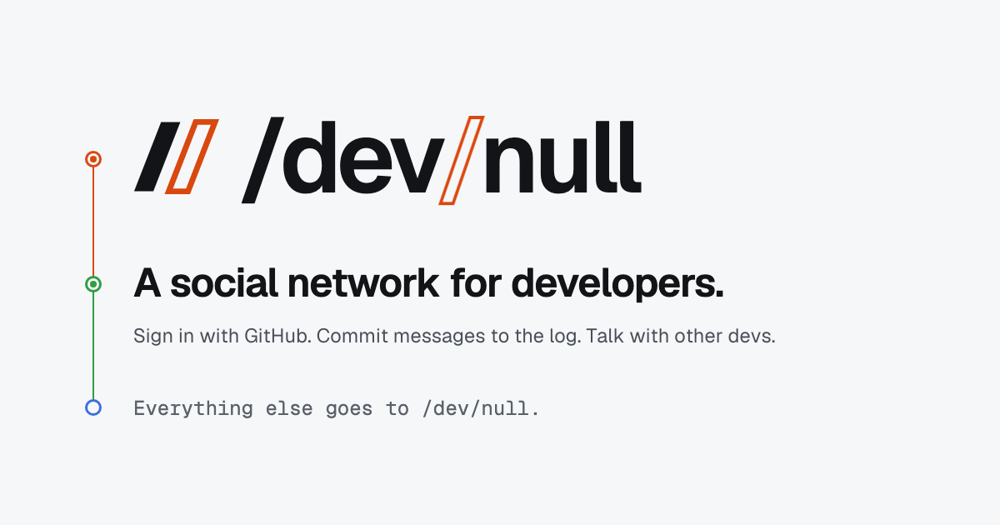

<p align="center">
    
    <p align="center">
        <a href="https://github.com/dev-null-sh/dev-null.sh/actions"></a>
        <a href="https://dev-null.sh"></a>
        <a href="https://github.com/dev-null-sh/dev-null.sh/graphs/contributors"></a>
        <a href="composer.json"></a>
    </p>
</p>

------

This is the source code of **[dev-null.sh](https://dev-null.sh)**, a social network for developers. Sign in with GitHub, follow developers, and share commits.

/dev/null was started live on stream by [Nuno Maduro](https://github.com/nunomaduro), [Brent Roose](https://github.com/brendt), [Matthieu Napoli](https://github.com/mnapoli), and [Pauline Vos](https://github.com/paulinevos), and is built by its community. Anyone can open a pull request.

- Join at **[dev-null.sh »](https://dev-null.sh)**
- Read the story at **[dev-null.sh/about »](https://dev-null.sh/about)**
- Learn how it works in the **[knowledge base »](KNOWLEDGE_BASE.md)**

## Contributing

Requires PHP 8.5+, Composer, Bun, and PostgreSQL 17+ with `pgvector` and `pg_trgm`. Create a `devnull` database, then:

```bash
git clone https://github.com/dev-null-sh/dev-null.sh.git
cd dev-null.sh
composer setup
composer dev
```

Run `composer test` before opening a pull request.

### Amp orbs

Fresh orbs run `.agents/setup` to install PHP 8.5 (including PCOV), Composer 2,
the Bun version pinned in `package.json`, Node 26, and PostgreSQL 18 with
`pgvector` and `pg_trgm`. Setup installs locked dependencies, creates the local
`devnull` and `testing` databases, runs migrations, generates Wayfinder types,
and builds frontend assets. Amp snapshots these tools and dependencies so new
orbs can reuse them. Warm setup runs check the lockfiles without reinstalling
unchanged dependencies. `.agents/resume` only repairs runtime directories.

Setup preserves an existing `.env` and application key; otherwise it copies
`.env.example` and generates a key. External API credentials are optional for
local development and are not included in setup. The disposable database only
listens on loopback, uses passwordless local access, and disables durability
settings for speed. Do not use this database configuration outside an orb.

Run `amp orb services ensure` to start the supervised database and web preview
and print its portal URL. The preview serves the built assets; after frontend
changes, run `bun run build` to refresh them. Use the local sign-in dialog with
any username, without GitHub credentials. Demo data is optional: run
`php artisan db:seed` once when needed (the seeder is not idempotent).

## License

/dev/null is open-sourced software licensed under the **[MIT license](composer.json)**.
